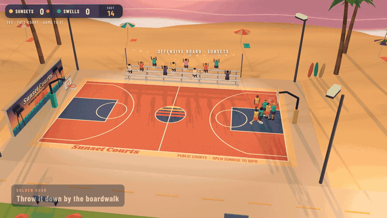

# Sunset Courts

**3v3 streetball by the Pacific.** A low-poly basketball court on a California beach, playable in the browser. Watch the AI run full games, or take the ball yourself.

▶ **[Watch the highlights](media/highlights.mp4)** (33 s, 1080p)

## Play

Open `index.html` in any modern browser. It's a single file with no build step and no install. three.js loads from a CDN.

To host it, turn on GitHub Pages for this repo (Settings → Pages → deploy from `main`, root). The game will be live at `https://jasonmayg.github.io/sunset-courts/`.

## Modes

Pick these from the start menu:

| Option | Choices |
| --- | --- |
| Mode | **Watch** (AI vs AI) or **Play** (you run the Sunsets) |
| Court | **Full** court, or **Half** court with streetball rules |
| Format | 1v1, 2v2, 3v3 |
| Game to | 11 or 21 |

In **Play** mode you control whoever has the ball. When you pass, control follows the ball to the teammate who catches it. On defense you control the player closest to the ball, and you can switch to another defender.

On a **half court**, you have to take the ball back past the three-point arc after every change of possession before you can shoot.

## Controls

| Action | Keyboard | Touch |
| --- | --- | --- |
| Move | WASD / arrow keys | Left stick |
| Sprint | Shift | RUN |
| Shoot / jump | Hold Space, let go in the gold band | Hold SHOOT |
| Pass / steal | E | PASS |
| Switch defender | Q | SWITCH |
| Menu | Esc | Menu button |

Drag to orbit the camera and scroll to zoom. **View** cycles camera angles and **Time** cycles the light.

Shooting uses a release meter. Let go inside the gold band for a perfect release. Sprint at the rim to dunk. A defender who jumps on a shot can block it.

## What's on the beach

- **Four kinds of light:** Marine Layer morning fog, Midday, Golden Hour, and floodlit Night, or an automatic cycle through all four
- **Ocean shader:** waves, a breaking shoreline with foam, and sun glint
- **Around the court:** swaying palms, lifeguard towers, umbrellas, surfboards, a pier with a turning Ferris wheel, and hills in the distance
- **Boardwalk life:** skaters, joggers and a cyclist, a taco truck, shops, cruising cars, string lights, and seagulls
- **Crowd:** fans in the bleachers who stand and cheer on big plays
- **Ball physics:** shots really hit the rim and backboard, so misses turn into live rebounds
- **Full set of plays:** dunks, layups, threes, blocks, steals, intercepted passes, fouls with free throws, and a 14-second shot clock

## Tech

- One HTML file with vanilla JavaScript and [three.js r128](https://threejs.org/)
- Static scenery is batched into a few vertex-colored meshes to keep draw calls low
- Custom shaders draw the sky gradient, sun and moon disk, stars, and the ocean
- Fonts are Shrikhand and Barlow Condensed from Google Fonts

The highlights video was recorded from the game itself. The game ran with a fixed random seed and a fixed timestep, each highlight was found by simulating ahead, and then the lead-up was rendered frame by frame.
